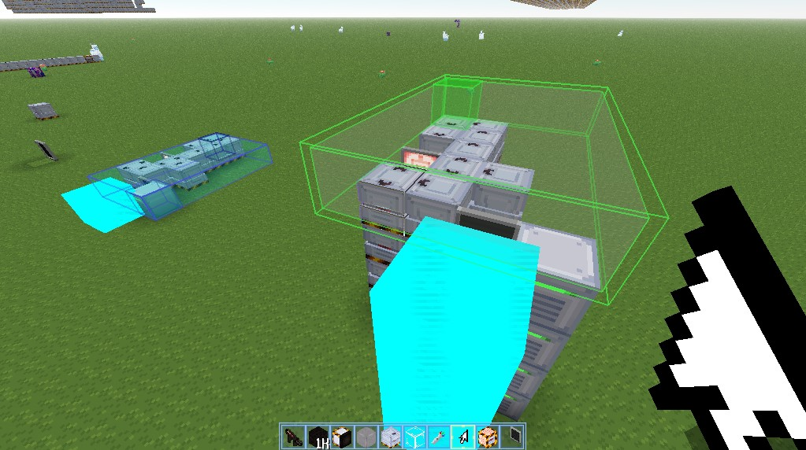
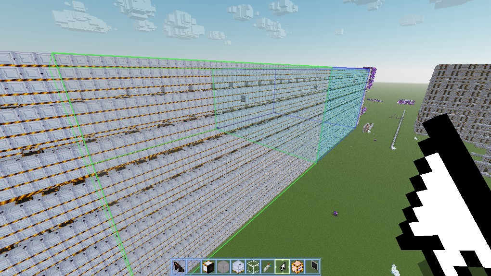
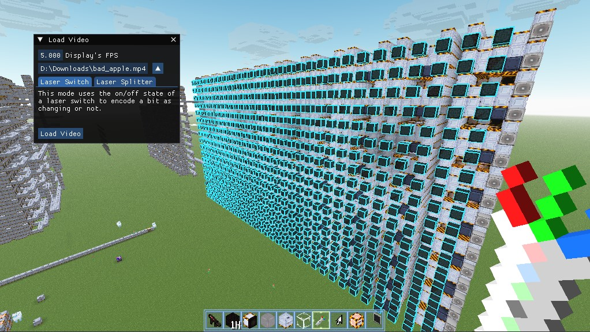
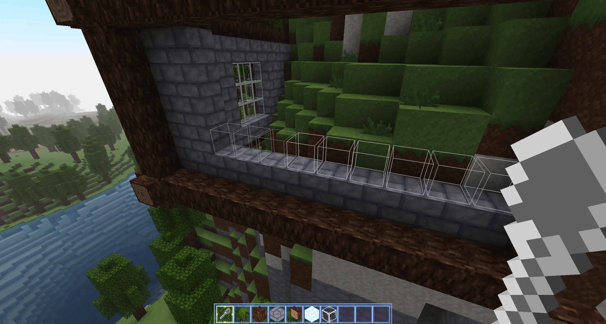

# Cosmic Tools

This mod adds various tools in the form of items that can make repetitive tasks easier.

> ![NOTE]
> This mod was previously compatible with servers, however that has not been a focus for the present version.
> This is to allow time to focus on just implementing the core features.

## Selection Wand

The selection wand is the primary tool for copying, pasting, duplicating, cutting and moving large regions of blocks.
It supports copying block entities, meaning that laser colour, hologram settings and so on remain preserved.

- `CTRL+NUMPAD_DOT` to set the first corner of the selection to the position of the block being looked at;
- `ALT+NUMPAD_DOT` to set the second corner of the selection to the position of the block being looked at;
- `NUMPAD_DOT` to set the paste origin to the position of the block being looked at.

With all three selection regions placed, all other actions are now viable.

### Moving Selections

Press `NUMPAD_0` to change the current point of focus. It will be highlighted with a pulsating outline. Move the
focused position by clicking the forward and backward buttons on your mouse, along with modifier keys:

- `FORWARD` or `BACKWARD` to move the focused position forward or backward relative to the view direction;
- `FORWARD+CTRL` or `BACKWARD+CTRL` to move the focused position left or right relative to the view direction;
- `FORWARD+ALT` or `BACKWARD+ALT` to move the focused position up or down relative to the view direction.

### Flipping Axes

The selection can be inverted along each axis when pasting. A red rectangle will appear on the sides of the selection
that are being inverted.

- `NUMPAD_1` flips the X axis;
- `NUMPAD_2` flips the Y axis;
- `NUMPAD_3` flips the Z axis;

### Actions on The Selection
Common operations are implemented for use with the selection and paste origin. The following actions
require modifier keys `CTRL_LEFT+ALT_LEFT` to be pressed at the same time:

- `D` to duplicate the selection at the paste origin. If the two selections overlap, the original selection will
be overridden;
- `X` to cut the selection. The selection is replaced with air and is pasted at the paste origin;
- `C` to copy the selection. The selection remains copied across worlds, making this a good way to bring builds
between worlds;
- `V` to paste the currently stored copy of the selection.

|  |  |
|---------------------------------------------|-----------------------------------------------|

## Display Wand

The Display Wand serves the sole purpose of loading video data into Read-Only Memory connected to a display (to
play Bad Apple). This requires OpenCV to be installed as a mod, which is done within the mod's menu.

### Setting up Parsing of The Display and ROM

The screen pixels must be properly identified for the tool to be able to back-propagate through the ROM's circuitry.
The following keybinds set the expected position of each pixel of the display. Each pixel of your display should
be paired up with a blue outline.

- `CTRL+NUMPAD_DOT` to set the top-left corner of the display to the position of the block being looked at;
- `ALT+NUMPAD_DOT` to set the bottom-right corner of the display to the position of the block being looked at;
- `UP` or `DOWN` to increment/decrement the vertical interval between pixels on the screen;
- `LEFT` or `RIGHT` to increment/decrement the horizontal interval between pixels on the screen;

Once all the pixels are exactly matched with a blue outline, proceed to the next step.

### Setting up The Video

Run the `/load_video` command to open a window with some video settings. If it is your first time running this
command, follow the steps to install OpenCV shown in the menu.

Set the frame-rate (FPS) to the rate at which your ROM can process one frame. This ensures that one second of video
is the same as one second in CR.

Now comes the confusing part, interpreting the ROM's circuitry. My ROMs use two methods to store a bit: within a
laser switch's on-off state; and within the presence of a laser emitter or lack-there-of.

The first mode is self-explanatory. If a laser switch is on, a laser can pass through and the bit is 1. If the laser
switch is off, a laser cannot pass through and the bit is 0. The remaining circuitry of the ROM serves to send laser
projectiles through the laser switches to check their state.

The second mode is a bit more confusing. If a laser emitter exists that can continue through the circuit, then the
bit is 1. If the path a laser takes is blocked, there is no laser emitter, then the bit is 0. Two adjacent ROM cells
can be merged by adding a laser splitter to the possible situations.

Suppose a laser splitter is placed along the vertical axis. There are four possible cases if we match the previous
system, accounting for the orientation of the laser emitter.
1. If there is a laser splitter, both the top bit and  bottom bit are 1.
2. If there is a laser emitter facing upwards, the top bit is 1 and the bottom bit is 0.
3. If there is a laser emitter facing downwards, the top bit is 0 and the bottom bit is 1.
4. If there is no laser emitter, both bits are 0.

Choose the most relevant interpretation for you ROM (or add you own to the mod; pull requests are welcome).

Click `Load Video` and the video should be loaded into your ROM.

## Wand (formerly Spatula)

The Wand is a more survival-oriented block placing tool. It mass-places many of the same block at once, matching the
pattern of already-placed blocks beside the currently selected block. Simply right-click and the blocks get placed
en-masse, matching the orientation of the sampled blocks.

## Scythe

The Scythe is a discontinued tool to harvest and automatically replant corn. It is not in a fully-functional state,
apologies.